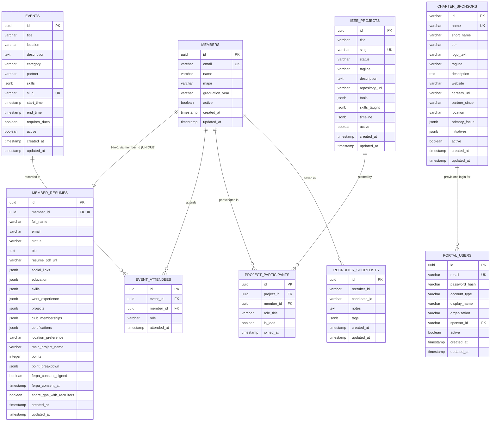

# RSO USF Member Catalog — Database Schemas & Data Model Specification (`Data.md`)

This document provides the authoritative reference for the database schemas, entity relationships, JSONB structures, and privacy compliance rules implemented in the **RSO USF Member Catalog**.

The database layer is managed using **PostgreSQL** and **Drizzle ORM** (located in [`src/db/schema.ts`](file:///c:/Users/talav/Documents/Github/Member-Catalog/src/db/schema.ts)).

---

## 1. Architectural Overview & Connections

The Member Catalog supports dual-runtime database connections through [`src/db/client.ts`](file:///c:/Users/talav/Documents/Github/Member-Catalog/src/db/client.ts):

* **Serverless Connection (Neon)**: Uses `@neondatabase/serverless` over WebSockets/HTTP for edge and serverless environments.
* **Standard PostgreSQL Connection (Node-Postgres)**: Uses `pg.Pool` with connection pooling for local development and self-hosted environments.
* **Seed Fallback**: When database connectivity is unavailable, API handlers automatically fall back to curated candidate and event datasets in [`src/db/seed.ts`](file:///c:/Users/talav/Documents/Github/Member-Catalog/src/db/seed.ts) and [`src/data/`](file:///c:/Users/talav/Documents/Github/Member-Catalog/src/data/).

---

## 2. Entity-Relationship Diagram (ERD)



---

## 3. Database Tables Reference

### 3.1 `members` & `member_resumes`
Stores candidate basic identities and enriched engineering portfolios:
- `status`: Career pursuit (`"Seeking Internship"` | `"Seeking Full-time"` | `"Employed"` | `"Seeking Co-op / Part-Time"`).
- `location_preference`: E.g., `"Tampa Bay / Local FL"`, `"Open to Relocation"`, `"Any"`.
- `skills`: Technical competencies acquired exclusively through verified workshop attendance.
- `points` & `point_breakdown`: Engagement score powering the default "Most Active" directory sorting.

### 3.2 `recruiter_shortlists`
Stores recruiter bookmarks, private evaluations, and candidate tags:
- `recruiter_id`: Corporate recruiter identifier or sponsor company key.
- `candidate_id`: Bookmarked member resume identifier.
- `notes`: Private evaluation notes (e.g. interview feedback, technical assessment notes).
- `tags`: Recruiter-assigned label chips (e.g. `["Hardware", "Summer 2026", "Top Candidate"]`).

### 3.3 `chapter_sponsors`
Stores company showcases and sponsorship partnerships:
- `tier`: One of `"Platinum"`, `"Gold"`, `"Silver"`, or `"Local Partner"`.
- `initiatives`: Funded grants and student chapter programs.

---

## 4. Resume Book Data Structures (`src/types/resumeBook.ts`)

### `ResumeBookOptions`
```typescript
export interface ResumeBookOptions {
  title: string;
  sponsorName: string;
  selectedMajor?: string;
  selectedGradYear?: string;
  sourceScope?: "all" | "search_results" | "shortlist";
  includeGpa?: boolean;
  includeProjects?: boolean;
  includeEvents?: boolean;
  includeDirectResumeLinks?: boolean;
}
```

### `ResumeBookCandidate`
```typescript
export interface ResumeBookCandidate {
  id: string;
  name: string;
  email: string;
  major: string;
  degree: string;
  gradDate: string;
  status: string;
  locationPreference?: string;
  gpa?: string;
  resumePdfUrl?: string;
  bio: string;
  verifiedSkills: string[];
  topProjects: Array<{ name: string; description: string }>;
  verifiedEvents: Array<{ title: string; category?: string }>;
  recruiterNotes?: string;
  shortlistTags?: string[];
}
```
