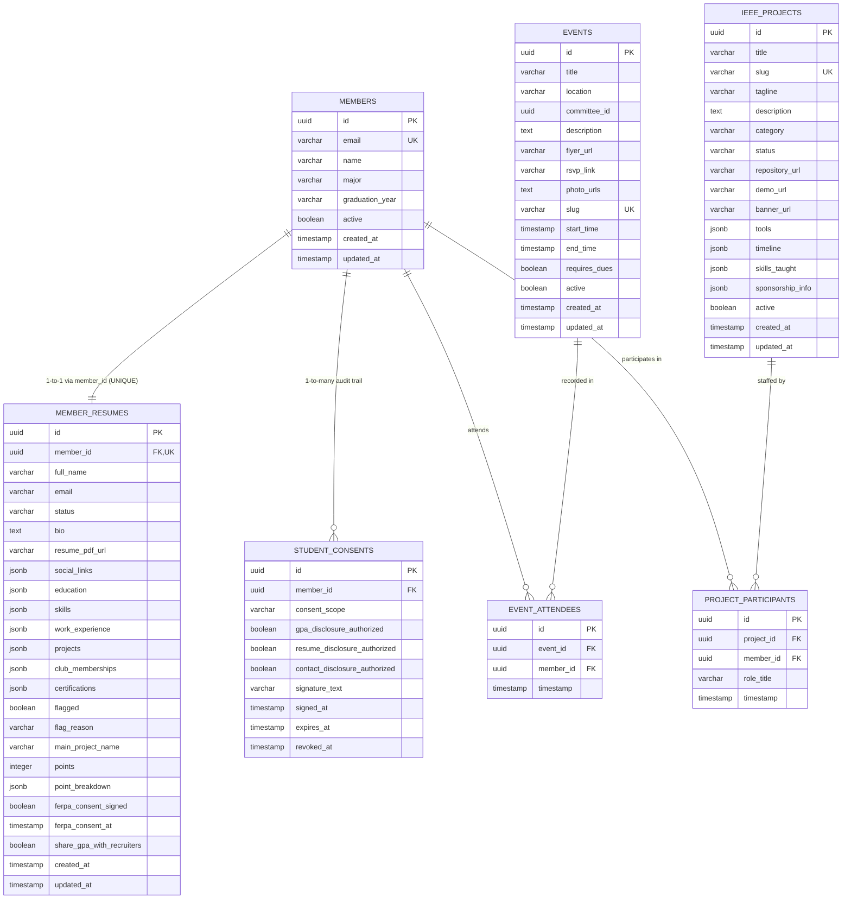

# Member Catalog Database Schemas & Data Model Specification

This document provides the authoritative reference for the database schemas, entity relationships, JSONB structures, and privacy compliance rules implemented in the **UCF IEEE Member Catalog**.

The database layer is managed using **PostgreSQL** and **Drizzle ORM** (located in [`src/db/schema.ts`](file:///c:/Users/talav/Documents/Github/Member-Catalog/src/db/schema.ts)).

---

## 1. Architectural Overview & Connections

The Member Catalog supports dual-runtime database connections through [`src/db/client.ts`](file:///c:/Users/talav/Documents/Github/Member-Catalog/src/db/client.ts):

* **Serverless Edge Connection (Neon)**: Uses `@neondatabase/serverless` over WebSockets/HTTP for edge and serverless environments.
* **Standard PostgreSQL Connection (Node-Postgres)**: Uses `pg.Pool` with connection reuse for local development and self-hosted environments.
* **Graceful Seed Fallback**: When database connectivity is unavailable (e.g. in offline development or test runners), API handlers automatically fall back to the curated candidate and event datasets in [`src/db/seed.ts`](file:///c:/Users/talav/Documents/Github/Member-Catalog/src/db/seed.ts) and [`src/data/`](file:///c:/Users/talav/Documents/Github/Member-Catalog/src/data/).

---

## 2. Entity-Relationship Diagram (ERD)



---

## 3. Relational Table Definitions

### 3.1 `members` Table
Represents the core student entity across IEEE chapter records.

| Column | Type | Constraints / Modifiers | Description |
| :--- | :--- | :--- | :--- |
| `id` | `uuid` | PRIMARY KEY, default: `gen_random_uuid()` | Unique member identifier. |
| `email` | `varchar(255)` | NOT NULL, UNIQUE | University/student primary email. |
| `name` | `varchar(100)` | Nullable | Full legal/display name. |
| `major` | `varchar(100)` | Nullable | Student primary degree major (e.g., Computer Science). |
| `graduation_year` | `varchar(10)` | Nullable | Expected or confirmed graduation year (e.g. `2026`). |
| `active` | `boolean` | NOT NULL, DEFAULT `true` | Membership activity status. |
| `created_at` | `timestamp` | NOT NULL, DEFAULT `now()` | Record creation timestamp. |
| `updated_at` | `timestamp` | NOT NULL, DEFAULT `now()` | Record last modification timestamp. |

---

### 3.2 `member_resumes` Table
Enforces a strict **1-to-1 relationship** with `members` through a unique foreign key constraint on `member_id`. Contains structured portfolio collections, moderation audit fields, Merit Point metrics, and FERPA consent configurations.

| Column | Type | Constraints / Modifiers | Description |
| :--- | :--- | :--- | :--- |
| `id` | `uuid` | PRIMARY KEY, default: `gen_random_uuid()` | Unique resume profile identifier. |
| `member_id` | `uuid` | NOT NULL, **UNIQUE**, REFERENCES `members.id` ON DELETE CASCADE | 1-to-1 foreign key to `members`. |
| `full_name` | `varchar(50)` | NOT NULL | Candidate display name. |
| `email` | `varchar(255)` | NOT NULL | Contact email. |
| `status` | `varchar(50)` | NOT NULL | Career status: `'Seeking Internship'`, `'Seeking Full-time'`, or `'Employed'`. |
| `bio` | `text` | NOT NULL | Personal bio / engineering overview. |
| `resume_pdf_url` | `varchar(200)` | NOT NULL | Direct link to candidate PDF resume file. |
| `social_links` | `jsonb` | NOT NULL, DEFAULT `'[]'::jsonb` | Array of social/portfolio links. *(See Schema 4.1)* |
| `education` | `jsonb` | NOT NULL, DEFAULT `'[]'::jsonb` | Array of academic degrees. *(See Schema 4.2)* |
| `skills` | `jsonb` | NOT NULL, DEFAULT `'[]'::jsonb` | Array of technical skill strings (up to 50 tags). |
| `work_experience` | `jsonb` | NOT NULL, DEFAULT `'[]'::jsonb` | Array of professional work experiences. *(See Schema 4.3)* |
| `projects` | `jsonb` | NOT NULL, DEFAULT `'[]'::jsonb` | Array of engineering projects. *(See Schema 4.4)* |
| `club_memberships` | `jsonb` | NOT NULL, DEFAULT `'[]'::jsonb` | Array of campus organization involvements. *(See Schema 4.5)* |
| `certifications` | `jsonb` | NOT NULL, DEFAULT `'[]'::jsonb` | Array of credentials/certifications. *(See Schema 4.6)* |
| `flagged` | `boolean` | NOT NULL, DEFAULT `false` | True if hidden from standard recruiter view pending moderation review. |
| `flag_reason` | `varchar(300)` | Nullable | Reason for moderation flag (e.g. AI slop report, duplicate profile). |
| `main_project_name` | `varchar(255)` | Nullable | Primary IEEE chapter build project featured on candidate profile. |
| `points` | `integer` | NOT NULL, DEFAULT `0` | Computed chapter merit score based on verified contributions. |
| `point_breakdown` | `jsonb` | Nullable | Detailed breakdown of points per category. *(See Schema 4.7)* |
| `ferpa_consent_signed` | `boolean` | NOT NULL, DEFAULT `false` | Affirmative consent indicator required by 34 CFR Part 99. |
| `ferpa_consent_at` | `timestamp with time zone` | Nullable | Timestamp when FERPA consent was executed. |
| `share_gpa_with_recruiters` | `boolean` | NOT NULL, DEFAULT `false` | Specific authorization permitting GPA disclosure to sponsors. |
| `created_at` | `timestamp` | NOT NULL, DEFAULT `now()` | Profile creation timestamp. |
| `updated_at` | `timestamp` | NOT NULL, DEFAULT `now()` | Profile last modification timestamp. |

---

### 3.3 `student_consents` Table
Full FERPA (34 CFR Part 99) compliance audit log documenting explicit disclosures authorized by the student.

| Column | Type | Constraints / Modifiers | Description |
| :--- | :--- | :--- | :--- |
| `id` | `uuid` | PRIMARY KEY, default: `gen_random_uuid()` | Unique consent record ID. |
| `member_id` | `uuid` | NOT NULL, REFERENCES `members.id` ON DELETE CASCADE | Associated student member ID. |
| `consent_scope` | `varchar(100)` | NOT NULL, DEFAULT `'recruiter_directory'` | Scope of consent grant. |
| `gpa_disclosure_authorized` | `boolean` | NOT NULL, DEFAULT `false` | Explicit grant to disclose cumulative GPA. |
| `resume_disclosure_authorized` | `boolean` | NOT NULL, DEFAULT `true` | Explicit grant to disclose resume PDF. |
| `contact_disclosure_authorized` | `boolean` | NOT NULL, DEFAULT `true` | Explicit grant to receive sponsor outreach. |
| `signature_text` | `varchar(255)` | NOT NULL | Electronic signature string submitted by student. |
| `signed_at` | `timestamp with time zone` | NOT NULL, DEFAULT `now()` | Execution timestamp. |
| `expires_at` | `timestamp with time zone` | Nullable | Expiration timestamp (typically 1 academic year). |
| `revoked_at` | `timestamp with time zone` | Nullable | Revocation timestamp if student withdraws consent. |

---

### 3.4 `events` Table
Official IEEE Student Chapter events, technical workshops, industry panels, and build sessions.

| Column | Type | Constraints / Modifiers | Description |
| :--- | :--- | :--- | :--- |
| `id` | `uuid` | PRIMARY KEY, default: `gen_random_uuid()` | Unique event ID. |
| `title` | `varchar(255)` | NOT NULL | Event title (e.g. `Embedded Firmware with FreeRTOS`). |
| `location` | `varchar(255)` | NOT NULL | Physical venue or virtual link (e.g., `HEC 101`). |
| `committee_id` | `uuid` | Nullable | Organizing committee identifier. |
| `description` | `text` | NOT NULL | Full event syllabus and learning objectives. |
| `flyer_url` | `varchar(500)` | Nullable | Promotional flyer banner image link. |
| `rsvp_link` | `varchar(500)` | Nullable | Registration / RSVP URL. |
| `photo_urls` | `text` | Nullable | Archive gallery photo URLs. |
| `slug` | `varchar(64)` | UNIQUE, Nullable | SEO-friendly URL slug (e.g. `freertos-workshop-2025`). |
| `start_time` | `timestamp with time zone` | NOT NULL | Event commencement date & time. |
| `end_time` | `timestamp with time zone` | Nullable | Event conclusion date & time. |
| `requires_dues` | `boolean` | NOT NULL, DEFAULT `false` | True if chapter dues membership is mandatory. |
| `active` | `boolean` | NOT NULL, DEFAULT `true` | Public visibility flag. |
| `created_at` | `timestamp with time zone` | NOT NULL, DEFAULT `now()` | Creation timestamp. |
| `updated_at` | `timestamp with time zone` | NOT NULL, DEFAULT `now()` | Last modification timestamp. |

---

### 3.5 `event_attendees` Table
Join table connecting verified student attendance to chapter events.

| Column | Type | Constraints / Modifiers | Description |
| :--- | :--- | :--- | :--- |
| `id` | `uuid` | PRIMARY KEY, default: `gen_random_uuid()` | Unique attendance record ID. |
| `event_id` | `uuid` | NOT NULL, REFERENCES `events.id` ON DELETE CASCADE | Event ID attended. |
| `member_id` | `uuid` | NOT NULL, REFERENCES `members.id` ON DELETE CASCADE | Attending student ID. |
| `timestamp` | `timestamp with time zone` | NOT NULL, DEFAULT `now()` | Verification timestamp. |

* **Unique Constraint**: `unique('event_attendees_event_member_unique').on(table.eventId, table.memberId)` ensures a student is recorded at most once per event.

---

### 3.6 `ieee_projects` Table
Official IEEE Student Chapter engineering build projects (Micromouse, Solar Car, Quadcopter, KnightOS, etc.).

| Column | Type | Constraints / Modifiers | Description |
| :--- | :--- | :--- | :--- |
| `id` | `uuid` | PRIMARY KEY, default: `gen_random_uuid()` | Unique project ID. |
| `title` | `varchar(255)` | NOT NULL | Project name. |
| `slug` | `varchar(64)` | NOT NULL, UNIQUE | URL slug identifier. |
| `tagline` | `varchar(300)` | Nullable | Short marketing punchline. |
| `description` | `text` | NOT NULL | Comprehensive technical narrative. |
| `category` | `varchar(100)` | NOT NULL | Category: `'Robotics'`, `'Embedded Systems'`, `'Software'`, `'Power'`, or `'AI'`. |
| `status` | `varchar(50)` | NOT NULL, DEFAULT `'Active'` | Status: `'Active'`, `'Completed'`, or `'In Development'`. |
| `repository_url` | `varchar(500)` | Nullable | GitHub / GitLab source repository URL. |
| `demo_url` | `varchar(500)` | Nullable | Live demo or project showcase website. |
| `banner_url` | `varchar(500)` | Nullable | Project hero banner image URL. |
| `tools` | `jsonb` | NOT NULL, DEFAULT `'[]'::jsonb` | Hardware/software tools utilized. *(See Schema 4.8)* |
| `timeline` | `jsonb` | NOT NULL, DEFAULT `'[]'::jsonb` | Milestone milestones and progress markers. *(See Schema 4.9)* |
| `skills_taught` | `jsonb` | NOT NULL, DEFAULT `'[]'::jsonb` | Array of skill strings acquired by contributors. |
| `sponsorship_info` | `jsonb` | Nullable | Corporate funding tiers, budget breakdown, and goals. |
| `active` | `boolean` | NOT NULL, DEFAULT `true` | Public directory display toggle. |
| `created_at` | `timestamp with time zone` | NOT NULL, DEFAULT `now()` | Record creation timestamp. |
| `updated_at` | `timestamp with time zone` | NOT NULL, DEFAULT `now()` | Record modification timestamp. |

---

### 3.7 `project_participants` Table
Join table connecting members to official IEEE chapter project teams with designated role titles.

| Column | Type | Constraints / Modifiers | Description |
| :--- | :--- | :--- | :--- |
| `id` | `uuid` | PRIMARY KEY, default: `gen_random_uuid()` | Unique participation record ID. |
| `project_id` | `uuid` | NOT NULL, REFERENCES `ieee_projects.id` ON DELETE CASCADE | Associated project ID. |
| `member_id` | `uuid` | NOT NULL, REFERENCES `members.id` ON DELETE CASCADE | Student contributor ID. |
| `role_title` | `varchar(100)` | NOT NULL, DEFAULT `'Team Member'` | Role designation (e.g. `Firmware Lead`, `PCB Designer`). |
| `timestamp` | `timestamp with time zone` | NOT NULL, DEFAULT `now()` | Join timestamp. |

* **Unique Constraint**: `unique('project_participants_project_member_unique').on(table.projectId, table.memberId)` ensures a student has one designated role per project.

---

## 4. Structured JSONB Sub-Schemas

### 4.1 Social Links (`member_resumes.social_links`)
```typescript
Array<{
  platformName: string; // "GitHub" | "LinkedIn" | "Portfolio" | "Twitter"
  profileUrl: string;   // Sanitized HTTP/HTTPS URL
}>
```

### 4.2 Education History (`member_resumes.education`)
```typescript
Array<{
  schoolName: string;   // e.g. "University of Central Florida" (max 100 chars)
  degreeType: string;   // e.g. "Bachelor of Science"
  major: string;        // e.g. "Computer Engineering"
  gpa?: number;         // 0.00 to 4.00 (Redacted unless authorized under FERPA)
  gpaScale?: number;    // Usually 4.0
  startDate: string;    // YYYY-MM-DD
  endDate?: string;     // YYYY-MM-DD
  isCurrent: boolean;   // Currently enrolled
  description?: string; // Honors, coursework, or special designations
}>
```

### 4.3 Work Experience (`member_resumes.work_experience`)
```typescript
Array<{
  companyName: string;  // e.g. "Lockheed Martin", "Siemens Energy"
  jobTitle: string;     // e.g. "Embedded Systems Intern"
  startDate: string;    // YYYY-MM-DD
  endDate?: string;     // YYYY-MM-DD
  isCurrentJob: boolean;// Active role
  description: string;  // Accomplishment bullets (max 1,000 chars)
}>
```

### 4.4 Projects (`member_resumes.projects`)
```typescript
Array<{
  projectName: string;  // Project title
  description: string;  // Project technical summary
  startDate: string;    // YYYY-MM-DD
  endDate?: string;     // YYYY-MM-DD
  isOngoing: boolean;   // Active build
  projectLinks: string[];// Sanitized external URLs (GitHub, demo)
}>
```

### 4.5 Club Memberships (`member_resumes.club_memberships`)
```typescript
Array<{
  clubName: string;     // e.g. "IEEE UCF Student Chapter"
  roleTitle: string;    // e.g. "Hardware Committee Chair", "Active Member"
  startDate: string;    // YYYY-MM-DD
  endDate?: string;     // YYYY-MM-DD
  isActive: boolean;    // Currently serving
  description?: string; // Responsibilities or initiatives
}>
```

### 4.6 Certifications (`member_resumes.certifications`)
```typescript
Array<{
  certificationName: string; // e.g. "CompTIA Security+ CE", "AWS Solutions Architect"
  issuer: string;            // e.g. "CompTIA", "Amazon Web Services"
  issueDate: string;         // YYYY-MM-DD
  expirationDate?: string;   // YYYY-MM-DD
  credentialId?: string;     // Verification ID
  credentialUrl?: string;    // Verification hyperlink
}>
```

### 4.7 Point Breakdown (`member_resumes.point_breakdown`)
```typescript
{
  total: number;                   // Cumulative merit points
  boardPoints: number;             // Points from chapter executive/board roles
  projectLeadPoints: number;       // Points from leading official IEEE build teams
  universityProjectPoints: number; // Points from contributing to chapter projects
  eventPoints: number;             // Points from verified workshop/event attendances
  committeePoints: number;         // Points from committee leadership
  details: string[];               // Human-readable audit log lines
}
```

### 4.8 Project Tooling (`ieee_projects.tools`)
```typescript
Array<{
  name: string;      // e.g. "Altium Designer", "FreeRTOS", "ROS2", "Next.js"
  category?: string; // "Hardware" | "Software" | "Firmware" | "Testing"
  icon?: string;     // Icon reference name
}>
```

### 4.9 Project Timeline Milestones (`ieee_projects.timeline`)
```typescript
Array<{
  date: string;        // e.g. "Fall 2024" or "2024-10-15"
  title: string;       // Milestone title
  description: string; // Milestone achievements
  status: "completed" | "in_progress" | "upcoming";
}>
```

---

## 5. FERPA Privacy & Disclosure Protocol (34 CFR Part 99)

The Member Catalog strictly enforces federal student privacy regulations:

1. **GPA Redaction Policy**:
   - In [`src/app/api/members/route.ts`](file:///c:/Users/talav/Documents/Github/Member-Catalog/src/app/api/members/route.ts), cumulative GPA is **never returned** to unauthenticated or standard public requests.
   - GPA is included *only* when the caller has an authorized recruiter role (`sponsor` or `admin`) **AND** the candidate has affirmatively checked `share_gpa_with_recruiters` / executed `ferpa_consent_signed`.
2. **Affirmative Directory Consent**:
   - Students must execute electronic affirmative consent (`ferpa_consent_signed = true`) before educational records, resume PDFs, or contact details are published to the recruiter directory.
3. **Audit Trail**:
   - Every consent action is logged in `student_consents` with electronic signature, timestamp, and permission scopes.

---

## 6. Seeding & Database Operations

```bash
# Seed local or remote PostgreSQL with candidate profiles, events, and rosters:
pnpm db:seed
```

The seed script ([`src/db/seed.ts`](file:///c:/Users/talav/Documents/Github/Member-Catalog/src/db/seed.ts)):
1. Creates schema tables if not present via PostgreSQL statements.
2. Ingests 42 candidate profiles (`DENSE_CANDIDATES`) with realistic UCF engineering degrees, skills, and project links.
3. Computes Merit Ranking points via [`calculateCandidatePoints()`](file:///c:/Users/talav/Documents/Github/Member-Catalog/src/lib/points.ts).
4. Seeds official IEEE events and establishes verified attendance rosters via `event_attendees`.
